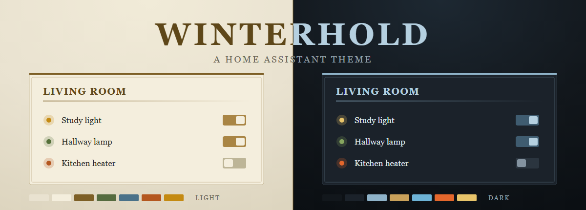

# Winterhold - Home Assistant Theme



Natural, earthy fantasy theme for Home Assistant, loosely inspired by the Elder Scrolls. Light mode is aged parchment and gold, dark mode is a cold slate night with frost blue.

## Install via HACS (custom repository)
1. HACS -> three-dot menu -> Custom repositories -> add this repo's GitHub URL, type **Theme**.
2. Download **Winterhold** from HACS.
3. Make sure `configuration.yaml` has `frontend: themes: !include_dir_merge_named themes`, then restart if you added it.
4. Profile -> Theme -> **Winterhold**.

## Manual install
1. Copy `themes/winterhold.yaml` to `/config/themes/`.
2. Add to `configuration.yaml`:
   ```yaml
   frontend:
     themes: !include_dir_merge_named themes
   ```
3. Developer Tools -> YAML -> Reload Themes.
4. Profile -> Theme -> **Winterhold**.

Optional: install [card-mod](https://github.com/thomasloven/lovelace-card-mod) from HACS for the ornamental card, header and sidebar styling. The theme works without it.

See [VERSION.md](VERSION.md) for the changelog.
